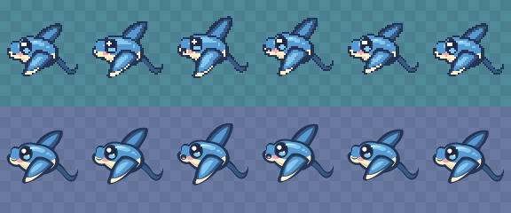

# ART-002 — Blueberry treatment checkpoint

Run f2a8b3a4-c3b1-4be2-9d4f-3a6012e8c533, lease generation 7. Base `06c27fd9034c3e0c0c2637300ba3e1c28f74e3b5`. GDD v2.0 §14; [task #10](https://github.com/hazelfjeld/Swarm-Autonomous-Game-Design/issues/10). **Trial, not selected production art.**

## Comparison and interaction
[Open local comparison](preview.html) (download/clone folder and open locally). Both original PNG strips use exactly the same 96 CSS-pixel canvas in the same city and six-actor battle layout. Pixel is a 48px native binary-alpha raster at nearest ×2; cartoon is 96px raster with 3× supersampled edges. Both preserve a soft snoot, large near eye, floppy wing, cream underside and tapering curled tail. One 720ms feeding response: 6 × 120ms frames (idle → anticipation → bite → lift → settle → idle). The preview fixture commits one illustrative 15 Food debit and one pip before animating; this is not a gameplay/economy implementation or approved cost. Reduced motion retains status text and the debit. Only Blueberry has art; five other battle slots are labeled placeholders. No actual game host or engine integration.

## Evidence and effort
- Source is [build-blueberry.mjs](build-blueberry.mjs); no dependency on generation providers. Three PNG outputs generated in 5308 ms measured wall time for the first execution in the connector JS environment; two complete builds matched byte-for-byte. This measures renderer runtime, not human artist hours. Total authoring effort not instrumented; no fabricated per-style estimate.
- Manifest records per-frame alpha bounds, opaque/partial pixels, source size, filter, center pivot, padding, palette, cosmetic-mask convention and provenance.
- Executed in renderer: all 12 frames have at least 3 source pixels clear padding; pixel alpha binary; cartoon partial coverage present; final pose matches initial bytes. Pixel and cartoon each have 6 frames; actual renderer output delivered, not just prompts.
- Static frame review sheet generated; browser interaction, engine import, live hosted scale, human choice, reduced-motion interaction and aesthetic acceptance still require independent observation. Actual on-screen size here is the declared preview fixture, not measured in Godot.
- Original geometry only, no Fish World images, external art, new purchases or paid generation credits.

## Skill source
`hazelfjeld/Game-Design-AI-Skill@dc26ddb18adc18fbbe2221a8443a71a260de6022`: canonical game-designer/SKILL.md and production-and-collaboration, game-feel-and-accessibility, design-foundations modules fetched at pin; compare same interaction/scale, explicit outcome, separate human preference. No native image/audio plugin used.

## Handoff
Director and independent QA should inspect the matched frames and local preview, verify playback at normal scale and all five identity features in each pose; report actual findings and select only after Hazel's material preference is resolved. ARCH-002 can inspect the trial strips and proposed pivot/filter conventions without assuming final style or runtime contract. ART-003 remains gated on style decision and #9. No roster multiplication or merge by this role. Exact branch commit/PR recorded in the issue.
