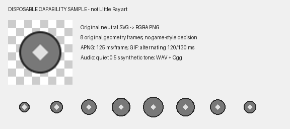

# ART-001: interactive asset capability evidence

- Role / task: `art-audio`, [ART-001 #6](https://github.com/hazelfjeld/Swarm-Autonomous-Game-Design/issues/6).
- Run / lease generation: `a599d694-05e1-4799-9c79-49bc97aaf575`, generation 1.
- Date: 2026-11-23 UTC; lease acquired at 23:38:58 UTC. The final issue handoff records completion and the delivered commit.
- Input commit: `08beacae99ea23394438cb2f61f8e7772b6ac47e`.
- Task branch: `swarm/art-audio/ART-001`; exact output commit and PR are recorded in #6 after publication.
- Result: disposable asset files, reproducible format checks, and observed generation capabilities. Independent acceptance/integration and the first scheduled run remain outstanding.

## Deliverable and design boundary

The [sample directory](samples/art-audio/) contains an editable SVG, transparent PNG, eight-frame strip, APNG/GIF previews, WAV/Ogg cue, static review sheet, an original image-generation result, and an original ElevenLabs sound result. These are **disposable capability samples, not Little Ray assets or a style proposal**. Keep them outside runtime asset directories.

Little Ray GDD v1.0 is received. The historical awaiting-GDD wording in ART-001 does not reopen intake or authorize a replacement design. Read the design baseline, first-slice plan, GDD vision/opening, §§11–12, stage-zero/one production gates, and §18. Preserve the baby-manta identity, compare pixel/cartoon Blueberry at the same actual play scale in ART-002, and obtain the appropriate director/user decision before multiplying variants. The GDD cover is concept reference; no original Fish World image was imported or used in these samples. ART-002 #10 and ART-003 #11 retain their current dependencies.



## Observed capabilities

| Capability | Actual execution and result | Limit |
| --- | --- | --- |
| Native image generation | One built-in `image_gen` call completed; the unchanged output is [generated-cube.png](samples/art-audio/generated-cube.png), 1536×1024 RGBA PNG, 1,212,426 bytes. Alpha contains 1,126,887 fully transparent pixels and 445,977 partially transparent pixels. | The cube has a visible soft halo and alpha reaches the image boundary; maximum alpha is 254. This proves generation and alpha output, not a clean production sprite, exact dimensions, or reliable atlas padding. No image-edit call was tested. |
| ElevenLabs SFX generation | One `eleven_text_to_sound_v2` generation completed in the connected workspace. [generated-tap.mp3](samples/art-audio/generated-tap.mp3) was downloaded, inspected, and decoded successfully: stereo MP3, 44.1 kHz, 50,187 bytes, 2.037551 seconds container duration. | Prompt asked for approximately one second; provider reports 2 seconds. Exact timing and perceptual quality are unverified. Provider returned a price of 16.665 existing-workspace credits; no new account, subscription, or purchase was made. |
| Editable vector and raster export | Inkscape 1.4 exported the original neutral SVG to 64×64 RGBA PNG, with both alpha 0 and 255 present. | This is geometry/export evidence, not mascot production. |
| Animation files | Pillow 13.0.0 wrote and decoded an eight-cell 512×64 strip, eight-frame APNG at 125 ms/frame, and eight-frame GIF with alternating 120/130 ms delays; both loops total 1 second. | GIF cannot represent 125 ms exactly. Animation playback in Godot/browser and character-animation consistency were not observed. |
| Local audio creation/export | Original 440 Hz enveloped waveform: 24,000 samples, 48 kHz mono PCM16 WAV, 0.5 seconds; FFmpeg 7.1.5 converted it to Vorbis Ogg and decoded both successfully. PCM peak 2,621; first/last samples zero. | No listening, subjective cue quality, browser autoplay, or audible engine playback claim. |
| Reproducible local samples | `python3 scripts/art_audio_capability_sample.py` returned PASS. A second build produced the same bytes for all nine outputs listed in `local-manifest.json`; independently recomputed hashes matched. | Encoder versions can change bytes. AI generation is not claimed to be deterministic. |
| Preview inspection | The 576×256 static review sheet was opened and inspected: labels fit and all eight original geometric frames are visible. The native generated cube was also visually inspected. | Static inspection is distinct from animation playback and human aesthetic acceptance. |
| GitHub delivery | Isolated `main` clone succeeded. Authenticated connector acquired/asserted the role lease and updated #6. This task uses connector Git objects/branch/PR for delivery and remote blob readback. Final commit/PR evidence belongs in #6. | `gh auth status` has no login; a noninteractive Git push dry-run failed for lack of credentials. The separately authenticated connector is the documented permitted route. |

### Available but not production-verified

Godot `--version` returned `4.7.2.stable.official.ed1daf0bf`; ImageMagick returned 7.1.1-43 and Blender 4.3.2. These version checks do not establish asset import, editing, rendering, or a playable build. Existing ARCH-001 engine evidence remains in [architect.md](architect.md); ARCH-002 owns the runtime interfaces and actual-host export check.

The ElevenLabs read-only node catalog succeeded and exposes music, speech, image/video, composition, and processing workflows. Only the single SFX generation above was executed. The catalog's newer SFX default and the callable schema differ; the explicitly available `eleven_text_to_sound_v2` schema was read before use. No music, voice, video, image-edit, voice-cloning, or background-removal workflow was verified.

No Aseprite, Krita, SoX, `aplay`, or `rsvg-convert` executable was found in the inspected default environment. Python lacked CairoSVG, soundfile, librosa, pydub, imageio, and cv2. These absences do not block the observed Inkscape/Pillow/FFmpeg path. Nothing was installed or purchased.

## Reproduction and evidence

From the repository root, with the observed local tools available:

```bash
python3 scripts/art_audio_capability_sample.py
ffprobe -v error -show_entries stream=codec_name,sample_rate,channels:format=duration,size -of json reports/capabilities/samples/art-audio/generated-tap.mp3
ffmpeg -v error -i reports/capabilities/samples/art-audio/generated-tap.mp3 -f null -
```

The first command rebuilds only the named original geometry/audio outputs, not the generated files. Observed output:

```json
{"result":"PASS","output":"reports/capabilities/samples/art-audio","assets":9,"apng_frames":8,"gif_frames":8,"loop_ms":1000,"audio_duration_seconds":0.5,"pcm_peak":2621}
```

[local-manifest.json](samples/art-audio/local-manifest.json) records actual formats, pivots, padding, timing, commands, tool versions, source hash, and asset SHA-256 values. [generation-provenance.json](samples/art-audio/generation-provenance.json) records the exact prompts, provider identifiers, decoded output properties, and hashes for the two unchanged generated files. No credentials, signed download URLs, or account handoff codes belong in the repository.

The locally authored geometry, synthesis and source script use no third-party asset inputs. Generated samples use the already authorized providers with no reference upload, copied image, voice sample, or music sample. They are capability evidence only; this report does not certify a commercial license or originality of future outputs. Record provenance and applicable use constraints separately for every production asset.

## Skill source evidence

| Skill / use | Source and exact revision | Files actually read | Retrieval / application |
| --- | --- | --- | --- |
| Game Designer / supporting | `hazelfjeld/Game-Design-AI-Skill` at `dc26ddb18adc18fbbe2221a8443a71a260de6022` | `game-designer/SKILL.md`, `references/production-and-collaboration.md`, `references/game-feel-and-accessibility.md` | Canonical GitHub reads at the pinned SHA succeeded. Applied bounded ownership, explicit evidence labels, and visible/accessible feedback requirements. No claim of installed-copy equivalence. |
| Image Generation / native | Installed `imagegen` SKILL.md at `/home/agent/.codex/skills/.system/imagegen` | Complete SKILL.md | Built-in generation selected; alpha preserved, original copied unchanged. Deterministic geometry used only for the separate code-native probe. |
| ElevenLabs Creative Studio / native | Installed plugin version `1.0.0` | Complete `creative-studio/SKILL.md` | Used connected media tool, one generation only, then retrieved the completed existing result. |
| ElevenLabs Sound Effects / supporting native guidance | Installed plugin version `1.0.0` | Complete `sound-effects/SKILL.md`; delegated audit also read its installation reference | Parameter/provenance guidance; actual live model schema controls connector calls. No SDK/API-key setup or CLI generation was assumed. |

All assigned canonical source files were retrieved. No required source module remains unread. `design-foundations.md` was not needed for this capability-only unit; treatment comparison is ART-002 work. No personal skill or skill-source repository was modified.

## Acceptance and next owner

- Interactive generation, local creation/export, static inspection, and file decode evidence are supplied. Repository publication/readback is recorded against the actual commit in #6.
- Independent QA acceptance and architect integration are pending; this role does not self-approve or merge.
- Director: after accepting ART-001's interactive evidence, reevaluate the existing ART-002 #10 readiness. Automation registration/first scheduled run are separately tracked and do not gate otherwise authorized interactive work.
- Art/audio: resume #6 review findings, or ART-002 once its live status is Ready. Compare one recognizable Blueberry interaction at real scale; do not start the three-ray pack before #11's named prerequisites are met.
- First actual scheduled environment: **unverified**. It must check its own tools and access; this interactive report cannot establish them.
- Automation ID, exact returned schedule, timezone, enabled state, uniqueness check, and creation/reuse outcome are recorded in the authoritative #6 startup registry comment after the service returns them. This file is not a second task registry.
